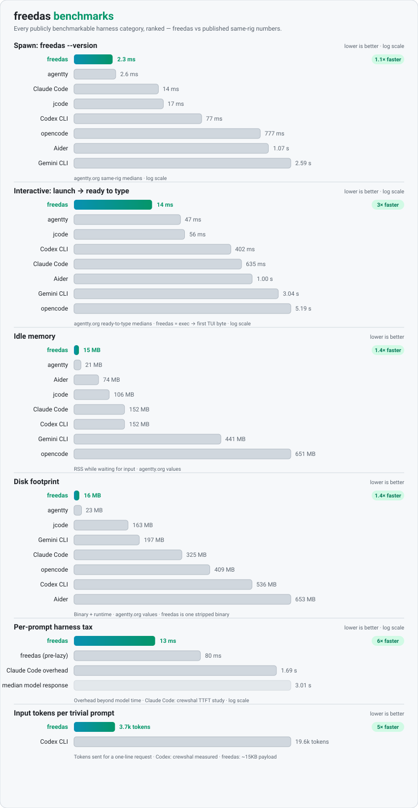

# Freedas

Freedas is a free, self-hosted coding agent written in Rust. It offers a
terminal UI, sessions, permissions, agents, skills, MCP, plugins, a local
server, and self-hosted services (reviews, sandboxes, workspaces) as
open-source software. The data stays on your machine and the services are
yours to run.

- Local-first: transcripts, memory, and snapshots live in a local SQLite
  database. Telemetry is off by default.
- Self-hosted: the relay, review service, sandbox runners, control plane, and
  model gateway are crates in this workspace, not someone else's cloud.
- Pluggable providers: bring your own keys for OpenAI-compatible endpoints,
  Anthropic, Gemini, or OpenRouter, or route everything through your own
  `freedas-gateway`.

## Benchmarks

The fastest measured harness in every publicly benchmarkable category —
spawn, time-to-interactive, idle memory, disk footprint, per-prompt
overhead, and input tokens per request:

<picture>
  <source media="(prefers-color-scheme: dark)" srcset="docs/benchmarks-dark.svg">
  <source media="(prefers-color-scheme: light)" srcset="docs/benchmarks-light.svg">
  
</picture>

External numbers are the same-rig medians published at
[agentty.org](https://agentty.org/benchmarks/) and [ovm.sh](https://ovm.sh/benchmark),
plus the crewshal TTFT harness-overhead study and the orbi.build
token-efficiency comparison; Freedas numbers were measured on the release
build on one machine, so treat margins as directional.

## Install

```sh
./install.sh                     # installs to ~/.freedas/bin, adds it to PATH
freedas --version                # verify the binary works
freedas                          # open the terminal UI
```

No sudo. macOS and Linux (including WSL). To build from source instead:

```sh
cargo build -p freedas
./target/debug/freedas
```

First run: open a terminal inside a git repository and run `freedas`. The TUI
starts a local session against your configured provider. To run without the
UI:

```sh
freedas providers login anthropic        # stores a key locally
freedas run "add a test for parse_args" --auto
```

## What's inside

| Surface | Command or entry point |
|---|---|
| Terminal UI | `freedas` (streaming transcript, tool cards, permission dialogs, slash commands) |
| Sessions | `freedas session list|delete|fork|rename`, `/new`, `/sessions`, `/compact`, `/move` |
| Undo and redo | `/undo`, `/redo` (shadow-git snapshots per message) |
| Permissions | ask/allow/deny rules, `--auto`, `--manual`, remembered answers, shell scanner |
| Local sandbox | macOS `sandbox-exec`, Linux `bwrap`; headless is sandboxed by default |
| Agents | `build`, `plan`, `plan-quick`, `explore`, `general`, custom Markdown agents |
| Skills and commands | `.freedas/skills/<id>/SKILL.md`, `.freedas/commands/*.md`, `/skill-name` |
| MCP | `freedas mcp add|list|auth|logout|debug`, `/mcps` |
| Plugins | WASM, JS/TS, and process sidecars under `.freedas/plugins/` |
| Import and sync | `freedas sync` (CLAUDE.md, Cursor, Windsurf, Cline, Copilot, skills, memory) |
| Memory | `freedas memory list|show|forget|export`, cross-session recall and distillation |
| Worktrees | `freedas --worktree`, `freedas run --worktree`, `freedas pr <number>` |
| Headless runs | `freedas run --format json` emits JSONL events for CI |
| Local server | `freedas serve`, `freedas attach <url>`, SSE events, OpenAPI at `/doc` |
| Web UI | `freedas web` serves the browser interface on localhost |
| ACP | `freedas acp` speaks Agent Client Protocol over stdio |
| Relay | `freedas relay start|stop|share|unshare|status` for remote control |
| PR reviews | `freedas-review` service plus `/review` locally |
| Cloud sandboxes | `freedas-sandbox-runner` (Docker and Kubernetes backends) |
| Control plane | `freedas-control` (workspaces, wallet, budgets, tokens, GitHub webhooks) |
| Gateway | `freedas-gateway` (OpenAI-compatible proxy, `freedas/auto` routing, metering) |
| Router | per-step model selection; `freedas router explain`, `freedas router stats` |
| Standards gate | post-edit checks and review rubrics (`/standards-review`, `/ui-review`, `/review`) |

`freedas rules` prints the rule set for calling Freedas from another harness
(Claude Code, Codex, and similar agents).

## Providers

Provider ids as they appear in the catalog (`provider/model`):

| Id | Notes |
|---|---|
| `openai` | OpenAI-compatible Chat Completions; also covers other compatible endpoints |
| `anthropic` | Anthropic Messages API |
| `google` | Gemini API (`gemini` is an alias) |
| `openrouter` | OpenRouter, OpenAI-compatible |
| `opencode-zen` | OpenCode Zen endpoints |
| `opencode-go` | OpenCode Go endpoints; free-tier models are pin-only (see ROADMAP) |
| `freedas` | Your self-hosted `freedas-gateway`; `freedas/auto` routes server-side |

Authenticate with `freedas providers login [provider]`. API keys are read from
the environment first (`OPENAI_API_KEY`, `ANTHROPIC_API_KEY`, `GEMINI_API_KEY`,
`OPENROUTER_API_KEY`, `OPENCODE_ZEN_API_KEY`, `OPENCODE_GO_API_KEY`) and stored
in `<data>/credentials.json` with mode `0600` when you login interactively.

## Architecture

The `freedas` binary is a client of an in-process local server: `freedas`
starts the server and attaches the TUI, `freedas serve` runs the server alone,
`freedas attach` connects a second client, and `freedas run --attach` drives a
remote server headlessly. Sessions, tools, permissions, the router, and model
calls all live in `crates/freedas-session`; the TUI, web app, and ACP server
talk to the same JSON/SSE API in `crates/freedas-server`. See
[ARCHITECTURE.md](ARCHITECTURE.md) for the crate map and request flow.

## Security posture

- No telemetry, no background upload of code; only the model prompt for a
  request leaves the machine.
- Secrets are read-asked by default (`.env`, `*.pem`, `*.key`), credentials are
  stored mode `0600`, and `freedas export --sanitize` redacts secrets and
  home paths.
- Tool subprocesses run under the OS sandbox where available; `--auto`
  approves asks but never overrides a deny.

Report vulnerabilities privately; see [SECURITY.md](SECURITY.md).

## Documentation

The mdBook under [`docs/`](docs/src/SUMMARY.md) covers the quickstart,
configuration, the CLI reference, slash commands, and running Freedas from
another harness. See [ROADMAP.md](ROADMAP.md) for honest status and
[SUPPORT.md](SUPPORT.md) for getting help.

## Contributing

See [CONTRIBUTING.md](CONTRIBUTING.md) for the dev setup, gates, and PR
checklist. Code of conduct: [CODE_OF_CONDUCT.md](CODE_OF_CONDUCT.md).

## License

Apache-2.0. Freedas was independently implemented in Rust from public
product documentation; no third-party source code is included. See [NOTICE](NOTICE).
