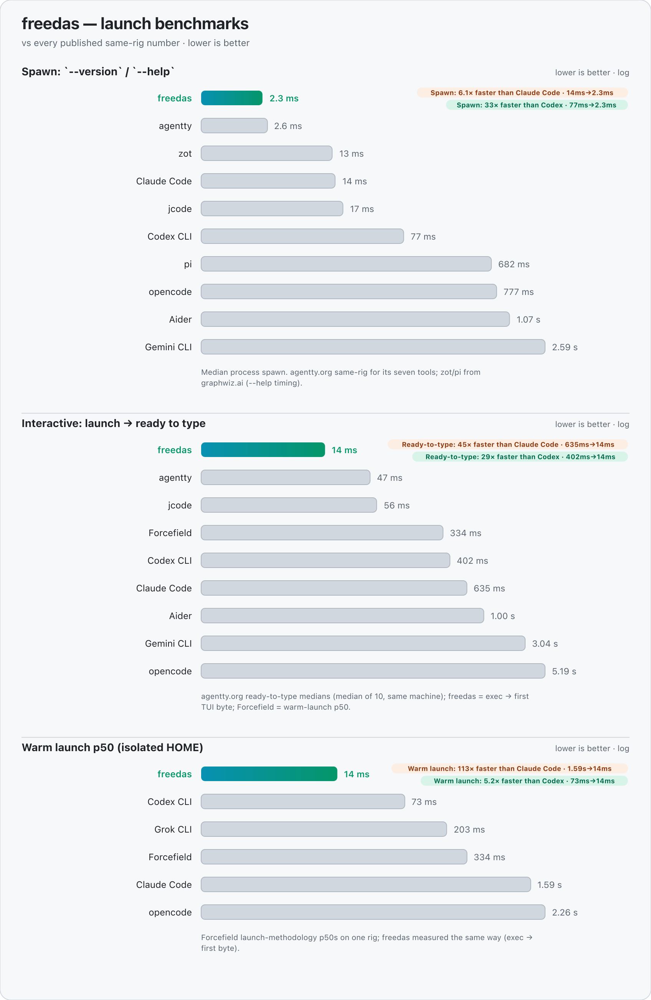
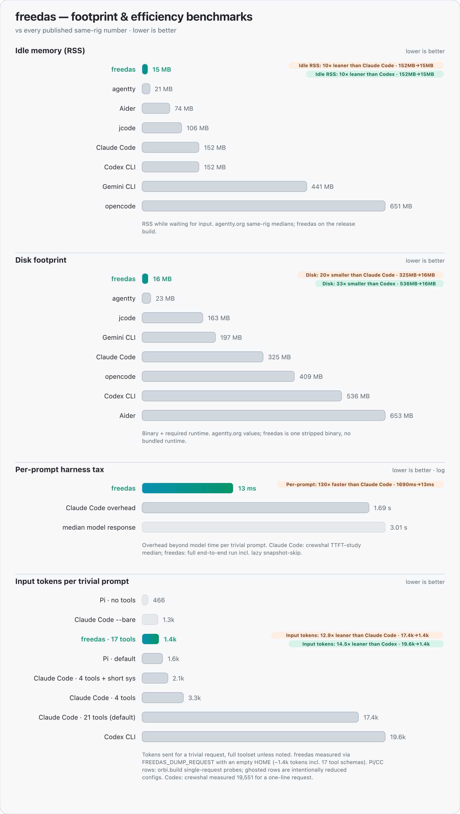
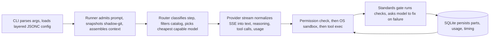

# Freedas

Free, self-hosted coding agent in Rust. You run it on your machine, point it at your provider keys, and keep transcripts, memory, and services under your control.

[](LICENSE)
[](Cargo.toml)
[](docs/src/install.md)

```sh
./install.sh
fd                               # open the terminal UI (shell shortcut for freedas)
```

No sudo. No account. The binary lands in `~/.freedas/bin`, the installer adds a `fd` shell function to your rc file, and the TUI opens in your current repo. `fd` passes every argument through, so `fd --worktree` works exactly like `freedas --worktree`.

## What this is

Freedas is one Rust workspace (31 crates) with one client binary plus optional services you can host yourself:

* You type in a terminal UI, run headless in CI, or drive the same session from a browser, an ACP client, or a second terminal.
* You bring provider keys for OpenAI-compatible endpoints, Anthropic, Gemini, or OpenRouter, or you route through your own `freedas-gateway`.
* Freedas stores sessions, todos, memory, usage, and snapshots in local SQLite with telemetry off by default.
* The relay, review service, sandbox runner, control plane, and model gateway live in this repo as crates, so you can run them or skip them.

If you know Codex, Cursor, or Devin, the shape will feel familiar. The difference is where the state lives: on your disk, in a schema you can read, behind commands you can script.

## Benchmarks

Same-rig, third-party launch and footprint comparisons, plus per-prompt overhead measured on the release build:

<picture>
  <source media="(prefers-color-scheme: dark)" srcset="docs/benchmarks-launch-dark-v7.png">
  <source media="(prefers-color-scheme: light)" srcset="docs/benchmarks-launch-light-v7.png">
  
</picture>

<picture>
  <source media="(prefers-color-scheme: dark)" srcset="docs/benchmarks-footprint-dark-v7.png">
  <source media="(prefers-color-scheme: light)" srcset="docs/benchmarks-footprint-light-v7.png">
  
</picture>

External launch numbers come from [agentty.org](https://agentty.org/benchmarks/), [ovm.sh](https://ovm.sh/benchmark), [graphwiz.ai](https://graphwiz.ai/), the Forcefield launch benchmark, and the crewshal TTFT harness-overhead study. Token efficiency comes from the orbi.build comparison. We measured Freedas numbers on the release build on one machine, so read margins as directional. The chart sources live in `scripts/gen_benchmarks.py` and `docs/benchmarks-*-v7.svg`.

## Install in one minute

```sh
./install.sh                     # installs to ~/.freedas/bin, adds it to PATH, adds the fd shortcut
freedas --version                # verify the binary
fd                              # open the terminal UI
```

The installer picks the asset matching your OS and CPU from the cargo-dist triples in `Cargo.toml`, verifies sha256 when the release publishes one, and defines `fd` as a shell function (fish and POSIX forms) so it still opens Freedas when fd-find owns `fd` on PATH. Reopen the terminal after install so the function loads.

Build from source instead:

```sh
cargo build -p freedas
./target/debug/freedas
```

Native Windows is not a release target. You run the Linux artifacts inside WSL.

## First run

Open a terminal inside a git repository and run `fd`. The TUI starts a local session against your configured provider. (`freedas` is the same binary when you need the full name in scripts.)

```sh
freedas providers login anthropic   # reads env first, stores to credentials.json mode 0600
freedas run "add a test for parse_args" --auto
```

Headless mode streams JSONL for scripts and CI:

```sh
freedas run --format json "fix the failing test" < task.txt
freedas run --worktree "refactor the router" --format json
```

`freedas rules` prints the rule set for calling Freedas from another harness such as Claude Code or Codex.

## Tour

### Terminal UI

`freedas` opens a streaming transcript with tool cards, diffs, permission dialogs, a session switcher, and slash commands (`/new`, `/sessions`, `/compact`, `/move`, `/undo`, `/redo`, `/review`, `/standards-review`, `/ui-review`).

### Sessions, undo, redo

| You run | You get |
|---|---|
| `freedas session list` | All local sessions with recency and cost |
| `freedas session fork <id>` | A copy you can take in another direction |
| `freedas session rename <id> <name>` | A readable name for the branch |
| `freedas session delete <id>` | Removal from local SQLite |
| `/undo`, `/redo` | Restore or reapply the shadow-git snapshot taken before the first mutation of a message |

Export when you need a record: JSON for tooling, Markdown for humans, `--sanitize` to redact secrets and home paths.

### Permissions and sandbox

You choose the posture per run: `--auto` approves asks but never overrides a deny, `--manual` asks every time, and remembered answers persist as allow/ask/deny rules with whole-string globs and last-match-wins. A shell scanner blocks catastrophic commands from a deny list, and dynamic constructs it cannot resolve fall back to ask (or deny in `--auto` for destructive ones).

Tool subprocesses run under the OS sandbox where available: `sandbox-exec` on macOS, `bwrap` on Linux. Headless runs stay sandboxed by default. Set `FREEDAS_EXPERIMENTAL_SANDBOX=false` only to opt out.

### Router that picks the model per step

The router in `crates/freedas-router` classifies each step (Planning, Debug, Refactor, Feature, Review, Upgrade, TestWrite, Edit, Docs, Explore), filters the catalog in `crates/freedas-catalog` by capability and quality floor, and picks the cheapest capable model. `freedas/auto` records the router decision. A pinned model records the concrete id.

```sh
freedas models                         # catalog with pricing, capabilities, quality priors
freedas router explain "fix this race" # see the classification and pick
freedas router stats                   # per task-class attempt, success, and cost learning
```

Free-tier OpenCode models stay pin-only. The router never selects them automatically because they only answer the OpenCode client. You can still call one with `--model opencode-go/<id>`.

### Agents, skills, commands

Built-in agents cover `build`, `plan`, `plan-quick`, `explore`, and `general`. You add your own as Markdown files in `.freedas/agents/` or `~/.config/freedas/agents/` with merge and disable semantics, then manage them with `freedas agent create` and `freedas agent list`.

Skills and slash commands follow the same file pattern:

* Skills live in `.freedas/skills/<id>/SKILL.md` with `agent`, `model`, and `subtask` frontmatter.
* Commands live in `.freedas/commands/*.md` with `$ARGUMENTS` and `$1` expansion.
* `freedas skill list|push|pull|forget` manages the registry, and `/skill-name` runs one inline.

### MCP and plugins

Freedas speaks MCP through an `rmcp` client over stdio and HTTP, with OAuth for remote servers:

```sh
freedas mcp add <name> -- <cmd>     # register a server
freedas mcp list                    # show configured servers
freedas mcp auth|logout|debug       # OAuth and inspection
```

MCP tools appear as `<server>_<tool>` in the runner. `/mcps` shows the same list inside the TUI.

Plugins extend the host three ways, each with its own boundary:

| Kind | Runtime | Boundary |
|---|---|---|
| WASM | wasmtime | No WASI, fuel and memory bounded |
| JS/TS | QuickJS | Memory and time capped, no Node native addons |
| Process sidecar | OS process | Trusted by recorded hash |

You keep plugins under `.freedas/plugins/` and manage them with `freedas plugin list|remove|update`.

### Memory, sync, worktrees

```sh
freedas memory list|show|forget|export  # FTS5 search with recency and confidence scoring
freedas sync                             # import CLAUDE.md, Cursor, Windsurf, Cline, Copilot rules, skills, memory
freedas --worktree                       # open the TUI on an isolated worktree
freedas run --worktree "try the risky refactor"
freedas pr 482                           # check out a pull request into a worktree
```

Recall uses FTS5 BM25 plus recency and confidence today. Provider-backed embeddings are on the roadmap, not wired yet.

### Server, web, ACP, relay

One local server backs every client. `freedas` starts it in process with the TUI attached. `freedas serve` runs it alone, `freedas attach <url>` connects a second client, and `freedas run --attach` drives a remote server headlessly. The API is JSON over axum with an SSE event bus and OpenAPI at `/doc`.

| Surface | Entry point |
|---|---|
| Local server | `freedas serve`, `freedas attach <url>` |
| Browser UI | `freedas web` serves the static SPA on localhost |
| Agent Client Protocol | `freedas acp` over stdio |
| Remote control | `freedas relay start|stop|share|unshare|status` |

Relay traffic stays outbound-only. Your machine opens a WebSocket to `freedas-relay-server`, which fans events to dashboard subscribers. You open no inbound port.

### Self-hosted services

Each service is a binary in this workspace with its own docs page under `docs/src/`. You can run any of them or none.

| Service | Binary | Job |
|---|---|---|
| Reviews | `freedas-review` | Verifies `X-Hub-Signature-256`, mints installation tokens, posts inline findings and check runs |
| Sandboxes | `freedas-sandbox-runner` | Leases queued rows, runs Docker or Kubernetes jobs, writes compute billing to the wallet |
| Control plane | `freedas-control` | Workspaces, memberships, budgets, wallet ledger, tokens, GitHub webhook intake |
| Gateway | `freedas-gateway` | OpenAI-compatible proxy, `freedas/auto` routing, workspace budget checks, usage metering |
| Benchmarks | `freedas bench run` | Task-suite runner with `--router` and `--model` ablations and `--json` output |

The control-plane services use PostgreSQL via `DATABASE_URL`. They have no SQLite backend, so integration tests for those paths need a real PostgreSQL instance.

### Standards gate

Configured format, lint, and test commands run after edits. A failure appends a synthetic message that asks the model to fix it, up to `max_attempts`, and emits `gate.passed` or `gate.failed` events. `/code-standards` and `/ui-standards` hold the rubrics.

## Providers

Provider ids match the catalog (`provider/model`):

| Id | Notes |
|---|---|
| `openai` | OpenAI-compatible Chat Completions, also covers other compatible endpoints |
| `anthropic` | Anthropic Messages API |
| `google` (`gemini` alias) | Gemini API |
| `openrouter` | OpenRouter, OpenAI-compatible |
| `opencode-zen` | OpenCode Zen endpoints |
| `opencode-go` | OpenCode Go endpoints, free-tier models are pin-only |
| `freedas` | Your self-hosted `freedas-gateway`, `freedas/auto` routes server-side |

Freedas reads keys from the environment first (`OPENAI_API_KEY`, `ANTHROPIC_API_KEY`, `GEMINI_API_KEY`, `OPENROUTER_API_KEY`, `OPENCODE_ZEN_API_KEY`, `OPENCODE_GO_API_KEY`), then from `<data>/credentials.json` written mode `0600` by `freedas providers login`.

## How a prompt becomes a tool call



Sessions, tools, permissions, router, and model calls live in `crates/freedas-session`. The TUI, web app, and ACP server talk to the same JSON/SSE API in `crates/freedas-server`. The full crate map and trust boundaries are in [ARCHITECTURE.md](ARCHITECTURE.md).

## Security posture

* No telemetry and no background upload of code. Only the model prompt for a request leaves the machine.
* Secrets stay read-asked by default (`.env`, `*.pem`, `*.key`). Credentials rest mode `0600`. `freedas export --sanitize` redacts secrets and home paths.
* Permission rules run first and the OS sandbox runs second. `--auto` never overrides a deny.
* Relay opens one outbound WebSocket and no inbound port. Plugins run without WASI in WASM, inside a capped QuickJS context, or behind a recorded hash for process sidecars.

Report vulnerabilities privately. See [SECURITY.md](SECURITY.md).

## Honest status

Shipped means the behavior exists and has tests. See [ROADMAP.md](ROADMAP.md) for the full list. Known limits today:

* The web UI is a zero-build static SPA, not the planned Leptos WASM app. It serves the same routes through the same JSON/SSE API, so the swap stays rendering-only.
* macOS sandboxing uses `sandbox-exec`, which Apple deprecated but still ships. If Apple removes it, Freedas falls back to permission prompts with a warning.
* JS plugins run in QuickJS, not Node. Modules that need Node APIs or native addons do not load.
* Memory recall has no provider embeddings yet.

Next: Leptos web app, OpenAI Responses API adapter, memory embeddings, published release artifacts via cargo-dist, and Kubernetes dry-run coverage in e2e.

## Documentation

The mdBook under [`docs/`](docs/src/SUMMARY.md) covers quickstart, installation, interactive and headless runs, plan mode, permissions, agents, skills, memory, MCP, plugins, sync, worktrees, router, server, web, ACP, relay, control plane, gateway, reviews, sandboxes, CLI reference, configuration, and troubleshooting. Start with the quickstart, then read the page for the surface you use.

* Getting help: [SUPPORT.md](SUPPORT.md)
* Status: [ROADMAP.md](ROADMAP.md)
* Design of the web UI: [DESIGN.md](DESIGN.md)

## Contributing

See [CONTRIBUTING.md](CONTRIBUTING.md) for dev setup, gates, and the PR checklist. Code of conduct: [CODE_OF_CONDUCT.md](CODE_OF_CONDUCT.md).

```sh
just check    # fmt, clippy with -D warnings, deny, audit, full test suite
just e2e      # builds and runs scripts/e2e.sh against the debug binary
just docs     # serves the mdBook locally
```

## License

Apache-2.0. Freedas was implemented in Rust from public product documentation. No third-party source code is included. See [NOTICE](NOTICE).
